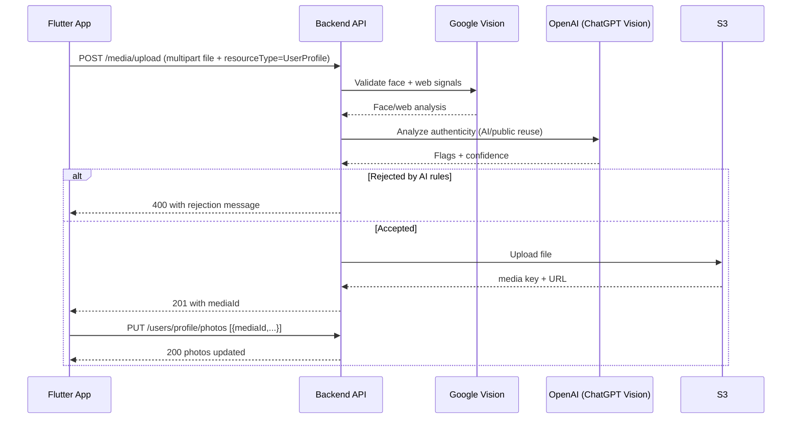

# Flutter Integration Guide: AI Image Check (Google Vision + ChatGPT) before S3 Upload

## 1. Goal

This guide explains how the Flutter app should upload profile photos using this backend flow:

1. Flutter sends image to backend upload API.
2. Backend runs AI checks:
   - Google Cloud Vision (face + web match signals)
   - ChatGPT Vision (synthetic/AI-generated and public-reuse reasoning)
3. If accepted, backend uploads to S3 and creates media record.
4. Flutter receives `mediaId`.
5. Flutter calls profile photos API to attach that `mediaId` to user profile.

If AI check fails, upload is rejected before profile is updated.

---

## 2. Current Backend APIs (Used by Flutter)

Base URL example:

- `https://api.yourdomain.com/api/v1`

### 2.1 Upload Image (AI check + S3)

- **Endpoint (authenticated app flow):** `POST /media/upload`
- **Auth:** Bearer token required
- **Content-Type:** `multipart/form-data`

Form-data fields:

- `file` (required): image binary
- `resourceType` (important): set to `UserProfile` to force profile-photo AI checks
- `resource` (optional): usually `profile_photo` or `gallery_photo`
- `alt` (optional)
- `caption` (optional)
- `description` (optional)
- `isPrimary` (optional)

Notes:

- Allowed mime types include: `image/jpeg`, `image/png`, `image/jpg`, `image/webp`, `image/gif`, `image/avif`, `image/heic`, `image/heif`
- Max size in current backend: `5MB`

Success response pattern:

```json
{
  "data": {
    "id": "9f5b57c0-c03e-4ee0-9d95-f0d701c61043",
    "userId": "...",
    "resource": "profile_photo",
    "url": "https://signed-s3-url...",
    "mediaKey": "uploads/...",
    "mimeType": "image/webp",
    "size": 243012
  },
  "message": "Media uploaded successfully. Pending approval."
}
```

AI rejection response examples (400):

```json
{
  "message": "Please upload a real, recent personal photo. AI-generated photos are not allowed.",
  "errorCode": "BAD_REQUEST"
}
```

```json
{
  "message": "This photo appears to be reused from public websites. Please upload your own recent profile photo.",
  "errorCode": "BAD_REQUEST"
}
```

Temporary AI provider busy response (400 in current implementation):

```json
{
  "message": "Photo verification is temporarily busy. Please wait a minute and try again.",
  "errorCode": "BAD_REQUEST"
}
```

### 2.2 Attach Uploaded Media to Profile Photos

- **Endpoint:** `PUT /users/profile/photos`
- **Auth:** Bearer token required
- **Content-Type:** `application/json`

Body (array of photo objects):

```json
[
  {
    "mediaId": "9f5b57c0-c03e-4ee0-9d95-f0d701c61043",
    "category": "profile",
    "isPrimary": true,
    "visibility": "public"
  }
]
```

Common values:

- `category`: `profile` or `gallery`
- `visibility`: `public`, `private`, `premium` (based on backend enum/config)

Success:

```json
{
  "data": { "...": "updated profile photo payload" },
  "message": "Photos updated successfully"
}
```

---

## 3. Backend AI Decision Logic (Important for Flutter Team)

When `resourceType=UserProfile` (or resource indicates profile/gallery photo), backend runs checks before S3 acceptance:

1. **Quick watermark/synthetic marker scan** (image corner pattern heuristic)
2. **Google Vision check**
   - face count / face validity
   - front-facing quality gate
   - web detection domains and matching signals
3. **OpenAI Vision (ChatGPT) check**
   - prompt-based authenticity assessment
   - returns flags like `ai_generated`, `stock`, `public_figure`, `model_pose`
   - confidence-based rejection

Backend rejects if confidence/conditions cross thresholds.

### Why some AI images still pass

Very realistic generated faces may pass if:

- no visible synthetic artifacts,
- no watermark,
- no strong web/public reuse signal,
- model confidence is below rejection threshold.

This is expected in any probabilistic moderation system. You improve it by tuning thresholds/prompt/rules, not by expecting 100% deterministic detection.

---

## 4. Flutter End-to-End Flow

## 4.1 UI Flow

1. User picks image.
2. Show crop screen.
3. On `Crop & Upload`:
   - call `POST /media/upload` with `resourceType=UserProfile`
4. If upload accepted:
   - read `data.id` as `mediaId`
   - call `PUT /users/profile/photos`
5. On final success:
   - refresh profile photos list/UI

## 4.2 Recommended State Machine

Use explicit states:

- `idle`
- `cropping`
- `uploading_for_ai_check`
- `ai_rejected`
- `media_uploaded`
- `attaching_to_profile`
- `completed`
- `failed`

Do not show “uploaded” in UI until step 2 (`PUT /users/profile/photos`) succeeds.

---

## 5. Flutter API Implementation (Dio example)

```dart
import 'dart:io';
import 'package:dio/dio.dart';

class MediaApi {
  final Dio dio;
  MediaApi(this.dio);

  Future<String> uploadProfileImage(File file, String token) async {
    final form = FormData.fromMap({
      'file': await MultipartFile.fromFile(file.path),
      'resourceType': 'UserProfile',
      'resource': 'profile_photo',
      'isPrimary': true,
    });

    final res = await dio.post(
      '/api/v1/media/upload',
      data: form,
      options: Options(
        headers: {'Authorization': 'Bearer $token'},
        contentType: 'multipart/form-data',
      ),
    );

    final mediaId = res.data['data']?['id'] as String?;
    if (mediaId == null || mediaId.isEmpty) {
      throw Exception('Upload succeeded but mediaId missing');
    }
    return mediaId;
  }

  Future<void> attachProfilePhoto({
    required String mediaId,
    required String token,
  }) async {
    final payload = [
      {
        'mediaId': mediaId,
        'category': 'profile',
        'isPrimary': true,
        'visibility': 'public',
      }
    ];

    await dio.put(
      '/api/v1/users/profile/photos',
      data: payload,
      options: Options(
        headers: {
          'Authorization': 'Bearer $token',
          'Content-Type': 'application/json',
        },
      ),
    );
  }
}
```

Usage:

```dart
Future<void> uploadAndAttachProfilePhoto(File file, String token) async {
  final mediaApi = MediaApi(dio);

  final mediaId = await mediaApi.uploadProfileImage(file, token);
  await mediaApi.attachProfilePhoto(mediaId: mediaId, token: token);
}
```

---

## 6. Error Handling Rules for Flutter

Map backend errors to user-facing messages:

- Contains `AI-generated photos are not allowed`:
  - show: `This photo looks AI-generated. Please upload a real recent photo.`
- Contains `reused from public websites`:
  - show: `This looks like a publicly reused image. Upload your own photo.`
- Contains `front-facing photo`:
  - show: `Please upload a clear front-facing photo.`
- Contains `temporarily busy` or status `429/502` from AI provider path:
  - show retry CTA and backoff

Retry strategy:

- 1st retry after 5s
- 2nd retry after 15s
- then manual retry button

Do not auto-loop retries infinitely.

---

## 7. Backend Environment Requirements

For this architecture to work, backend must have valid keys:

- Google Vision credentials (service account JSON or equivalent config used by `GoogleVisionService`)
- OpenAI API key for image analysis used by AI provider
- S3 credentials + bucket config

Also ensure OpenAI vision-capable model is configured (for example in backend config, default currently `gpt-4o-mini` unless changed).

---

## 8. Testing Checklist for Flutter QA

Use these scenarios:

1. Real front-facing selfie (expected pass)
2. Side-view face (expected fail for profile primary)
3. Cartoon/avatar illustration (expected fail)
4. Known stock/public image from web (expected fail)
5. AI-generated realistic portrait (should fail most times; track misses)
6. >5MB file (expected fail)
7. Unsupported mime type (expected fail)
8. Valid upload + profile attach sequence (expected pass)

For each test log:

- upload request ID/time
- status code
- backend message
- whether mediaId created
- whether profile photo updated

---

## 9. API Contract Summary (for Flutter Dev)

1. Always call upload with `resourceType=UserProfile`.
2. Treat upload and attach as two separate API calls.
3. Do not mark photo as successful in UI until attach call passes.
4. Show exact rejection reason from backend message where possible.
5. Implement retry for temporary AI/provider failures.

---

## 10. Optional Improvement Recommendations

If you need stricter AI-image blocking later:

1. Add perceptual hash dedup/public blacklist checks.
2. Add EXIF/camera metadata scoring (absence is a weak signal only).
3. Increase OpenAI rejection strictness prompt + lower AI confidence threshold.
4. Add secondary anti-synthetic model/provider as ensemble.
5. Maintain manual-review fallback queue for uncertain scores.

---

## 11. Sequence Diagram



---

## 12. Postman/cURL Example

Upload:

```bash
curl -X POST 'https://api.yourdomain.com/api/v1/media/upload' \
  -H 'Authorization: Bearer <TOKEN>' \
  -F 'file=@/path/photo.jpg' \
  -F 'resourceType=UserProfile' \
  -F 'resource=profile_photo' \
  -F 'isPrimary=true'
```

Attach to profile:

```bash
curl -X PUT 'https://api.yourdomain.com/api/v1/users/profile/photos' \
  -H 'Authorization: Bearer <TOKEN>' \
  -H 'Content-Type: application/json' \
  -d '[{"mediaId":"<MEDIA_ID>","category":"profile","isPrimary":true,"visibility":"public"}]'
```

---

## 13. Clarification: Google Vision + ChatGPT vs Gemini

Yes, you can run **Google Vision + ChatGPT** instead of **Google Vision + Gemini**. Your current backend flow already supports this pattern through the AI provider abstraction and OpenAI analysis call for authenticity checks.

If you want, backend can keep Gemini as fallback provider and use ChatGPT as primary.
