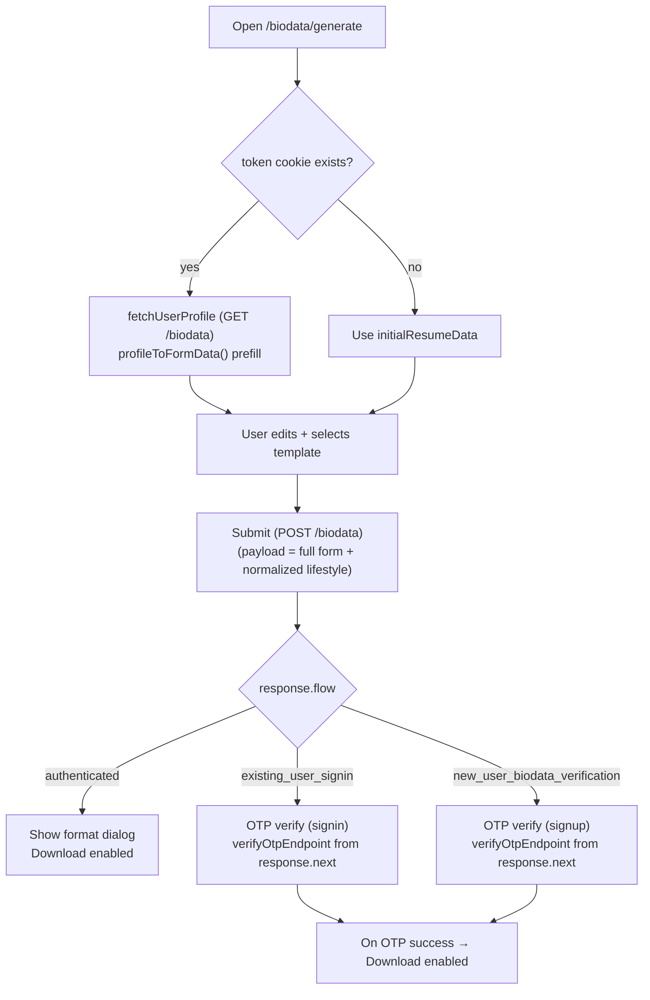

# Walima Biodata Generator — 1:1 Flutter Build Documentation

This document explains how the **Walima web biodata generator** (in this repo) works, and how to rebuild the **same feature** in Flutter as accurately as possible (flows, fields, templates, exports, and edge cases).

Source of truth in this repo:
- Route: `src/app/(site)/(public)/biodata/generate/page.tsx`
- Feature module: `src/packages/generate-biodata/`

---

## 1) Feature overview (what the user can do)

The biodata generator is a builder with:
- A **multi-step form** (Personal → Career → Education → Family → Preferences → Contact).
- A **template chooser** (12 templates: `mainBioData`, `designOne` … `designEleven`).
- A **live preview** rendered on an **A4-sized canvas**.
- Export:
  - **PDF** (multi-page) and
  - **PNG** (downloads each page separately).
- Auth-aware submission:
  - If the user is already authenticated (cookie `token` exists), biodata is immediately downloadable after save.
  - If unauthenticated, it triggers **OTP verification** flows (signin/signup) before allowing final download.

---

## 2) Web implementation map (so you can mirror it in Flutter)

### 2.1 Entry route

`src/app/(site)/(public)/biodata/generate/page.tsx`
- Reads cookie `token`.
- If token exists, calls `fetchUserProfile()` from `src/packages/generate-biodata/lib/biodata.action.ts`.
- Passes `initialData` to the builder module (`ResumeBuilder`).

### 2.2 API actions (server actions)

`src/packages/generate-biodata/lib/biodata.action.ts`
- `fetchUserProfile()`:
  - `GET /biodata` (via `serverAction`)
  - returns `User` profile used to prefill the form.
- `sendBiodataOtp(email)`:
  - `POST /auth/send-otp` with `{ email, purpose: 'signin' }`
- `downloadBiodata(payload)`:
  - `POST /biodata` with form/template payload to create/save biodata server-side.

Flutter should call the same endpoints with the same payload structure you define (see “Submission payload” below). If backend expects an exact structure, copy it from the web submission step (inspect `ResumeBuilder` submit logic and the request body sent to `downloadBiodata`).

### 2.3 Data model & validation

Form schema is defined by Zod:
- `src/packages/generate-biodata/data/validation.ts` → `resumeSchema`
- This is the “truth” for required fields, coercions, and nested objects.

Flutter should mirror:
- Required string trimming rules (web uses a `requiredString()` preprocessor that trims and enforces `.min(1)`).
- Coercion behaviors (some numeric fields use `z.coerce.number()`).
- Defaults (`z.array(...).default([])`).

### 2.4 User profile → form mapping

`src/packages/generate-biodata/templates/formatter.ts`
- `profileToFormData(user: User): ResumeData` is the single source of truth to prefill the form from API user profile.

Flutter must implement the exact same mapping so a logged-in user sees identical prefilled values.

### 2.5 Form → template data normalization

Also in `src/packages/generate-biodata/templates/formatter.ts`:
- `formatTemplateData(raw: ResumeData): TemplateData`

This creates a **template-friendly** object with:
- `personalInfo`, `professional`, `education`, `family`, `marriagePref`, `contacts`
- plus a `formatted` section (e.g., date of birth with age, height converted cm→feet/inches, enum prettifying).

Flutter must apply the same normalization before rendering templates.

### 2.6 Templates and page count

Template registry:
- `src/packages/generate-biodata/templates/templateRegistry.ts`

Template components and dynamic page counts:
- `src/packages/generate-biodata/templates/templates.ts`
  - `templateComponents[templateId]`
  - `templatePageCountFns[templateId]`

Some templates can change page count at runtime based on content length (e.g., address blocks). Flutter must implement the same rule per template (port the `getPageCount` logic from each template file).

### 2.7 Rendering and exporting (Konva + jsPDF)

Preview renderer:
- `src/packages/generate-biodata/preview/ResumePreview.tsx`

Key behavior to match:
- A4 canvas baseline:
  - Desktop: `595 x 842`
  - Mobile: `460 x 795` with different default scaling.
- Zoom and pan.
- Export PNG:
  - Iterates pages `1..totalPages`, switches page, renders, then downloads each page as separate PNG.
  - Uses `pixelRatio: 3` for higher resolution.
- Export PDF:
  - Uses `jsPDF` and embeds each page image.

Flutter equivalent should use:
- `printing` + `pdf` packages for PDF generation, or
- a “canvas-to-image” approach (e.g., `RepaintBoundary` → `ui.Image` → bytes) and then stitch into PDF.

To be “same to same”, prefer:
- Render each page at a fixed logical A4 size (matching 595×842 ratio).
- Export at high scale (equivalent of `pixelRatio: 3`).

---

## 3) Flutter architecture (recommended to match behavior)

### 3.1 Packages (suggested)

- State management: `flutter_bloc` (or `riverpod`), pick one and keep consistent.
- Forms + validation:
  - Option A: `reactive_forms` + custom validators (closest to schema-driven approach)
  - Option B: `formz` with Bloc
- Networking: `dio`
- JSON models: `freezed` + `json_serializable`
- PDF: `pdf` and `printing`
- Local storage: `shared_preferences` (to mimic `sessionStorage` submit session state)
- i18n: `flutter_localizations` + `intl` (web uses `useLocale().t(...)`)

### 3.2 High-level module structure

Implement a dedicated feature module, similar to `src/packages/generate-biodata/`:

```
lib/features/biodata/
  biodata_generate_page.dart
  data/
    biodata_models.dart            // ResumeData, TemplateData, User subset
    biodata_validation.dart        // validators mirroring resumeSchema
  domain/
    biodata_formatter.dart         // profileToFormData + formatTemplateData
    template_registry.dart         // templates + metadata
    template_page_count.dart       // per-template getPageCount ports
  application/
    biodata_bloc.dart              // UI state, form state, submission state
  presentation/
    steps/                         // Personal, Career, Education, ...
    preview/                       // preview + zoom/pan + page switch
    templates/                     // per-template painters/widgets
  infrastructure/
    biodata_api.dart               // fetchUserProfile, sendOtp, downloadBiodata
  assets/
    (in pubspec.yaml)              // copy /public/biodata into Flutter assets
```

---

## 4) Flutter data models you must mirror

### 4.1 ResumeData (form state)

Mirror `ResumeData` from:
- `src/packages/generate-biodata/data/validation.ts`

At minimum you need the same groups:
- `profile`
- `appearance`
- `locations[]`
- `educations[]`
- `professions[]`
- `family`
- `religion`
- `lifestyle`
- `preferences`
- `interests`
- `hobbies[]`
- `contacts[]`
- `photos[]`
- root `email`, `phone`, `signature`

Tip: Keep Flutter “form model” separate from API `User` model. Use a mapping layer like `profileToFormData()`.

### 4.2 TemplateData (render model)

Mirror `TemplateData` from:
- `src/packages/generate-biodata/templates/types.ts`

Do not render directly from `ResumeData`. Always render from `TemplateData` created by the formatter to match:
- height conversions
- age formatting
- enum formatting
- which profession/education record is treated as “primary”

---

## 5) Template rendering in Flutter (how to get 100% identical output)

The web uses React-Konva templates under:
- `src/packages/generate-biodata/templates/designs/`

Each template is effectively:
- A fixed A4 layout,
- With positioned text blocks,
- Decorations/background images from `/public/biodata/...`,
- Page switching via `currentPage`.

### Recommended approach (most accurate)

1) For each template, implement a **page renderer** that draws to a fixed-size canvas:
   - Use `CustomPainter` for vector drawing + positioned text.
   - Use `ui.Image` for decoration assets.
2) Use a shared coordinate system:
   - Adopt the same base size ratio as the web (A4 595×842).
   - In Flutter, choose a logical size like `595x842` “layout units” and scale to device.
3) Text measurement matters:
   - Use `TextPainter` with explicit fonts and letter spacing.
   - Implement line wrapping rules that match the web templates.
4) Page count:
   - Port each template’s `getPageCount(...)` logic from the web.

### Asset parity

Copy these assets into Flutter (same paths preferred):
- All of `src/packages/generate-biodata/public/biodata/` → Flutter `assets/biodata/`
- Ensure filenames and folder structure stay identical:
  - `assets/biodata/thumbnails/...`
  - `assets/biodata/designOne/...` etc
  - `assets/biodata/mainBioData/...`

In `pubspec.yaml`, expose them under `assets:` and load by path.

### Fonts parity

The web uses Google Fonts via:
- `src/packages/generate-biodata/fonts.ts`

For exact matching:
- Download the exact same font files (the same families/weights used by the templates).
- Bundle as Flutter fonts and reference them by family name.

If you do not match fonts/weights, line breaks and page counts will differ.

---

## 6) Export (PNG + PDF) in Flutter

### PNG export (per page)

Match the web behavior:
- Export each page as its own PNG file.
- Render at high resolution:
  - Web uses `pixelRatio: 3`. In Flutter, render at 3x device pixel ratio (or manually scale).

Implementation outline:
- For each page:
  - Set `currentPage`.
  - Render a `RepaintBoundary`.
  - Convert to `ui.Image`, then PNG bytes.
  - Save/share/download (platform-specific).

### PDF export (multi-page)

Match the web:
- Each page is an image embedded into a PDF with A4 page size.
- Use `pdf` package:
  - Create `pw.Document()`.
  - For each page, add `pw.Page` A4, draw the PNG bytes as full-page image.
  - Use `printing` for share/save.

---

## 7) Auth + OTP flows (mirror the web)

In the builder UI (`src/packages/generate-biodata/index.tsx`) there are multiple flows:
- Authenticated: user already signed in → save biodata → allow download.
- Existing user signin: account exists → send OTP for signin.
- New user biodata verification: OTP verification before finalizing.

Flutter should implement a small state machine similar to the web’s `BuilderUiState` and `SubmitSession`.

Persist a “submit session” locally (web uses `sessionStorage` key `walima:biodata-submit-session`):
- Save the email and flow state so the user can refresh/reopen and continue verification.
- Clear it on success.

Endpoints used by web:
- `POST /auth/send-otp` (purpose: `signin`)
- OTP verification endpoint is implemented by shared auth UI on web (`VerifyOtpForm`). Mirror the backend endpoint(s) used by that flow.

If you need the exact verify endpoint and payload:
- Inspect `VerifyOtpForm` and related auth actions in the web codebase and port them exactly.

---

## 8) Submission payload (what to POST to `/biodata`)

The web submits via:
- `downloadBiodata(payload)` → `POST /biodata`

To make Flutter 1:1 accurate, you must mirror the web payload exactly.

Concrete notes from web implementation (`src/packages/generate-biodata/index.tsx`):
- It posts **the full form object** (`watchedData`) as payload.
- It normalizes `lifestyle` before posting:
  - `diet`, `dietType`, and `foodHabits` are coerced to the first non-empty value among those three fields (so they stay in sync).
- It derives the “request email” like:
  - `payload.email` OR the first `contacts[]` item with `contactType === 'email'`.

Steps to extract the payload format:
1) Open `src/packages/generate-biodata/index.tsx`
2) Find the submit handler that calls `downloadBiodata(...)`
3) Copy the JSON structure:
   - included sections
   - template id
   - any normalized/flattened fields
   - attachments (photo urls vs uploaded files)

Then implement the same payload builder in Flutter:
- `ResumeData` (form state) → normalization → payload JSON.

---

## 9) Edge cases to match

To avoid “looks similar but not identical” differences:
- Trim all required strings the same way as the web.
- Keep numeric coercion consistent (empty string → 0 vs null matters).
- Handle `locations`, `educations`, `professions` arrays defaulting to `[]`.
- Primary photo selection must match the web:
  - primary profile picture if marked `isPrimary`, otherwise first item, otherwise default.
- Dynamic page count must match the template’s page splitting rules.
- Use identical fonts and font sizes; otherwise text wrapping changes output.

---

## 11) Flow diagram (web-equivalent state machine)



---

## 10) Implementation checklist (Flutter)

- [ ] Create `ResumeData` model matching web schema.
- [ ] Implement validators that match `resumeSchema`.
- [ ] Implement `profileToFormData(User)` mapping identical to web.
- [ ] Implement `formatTemplateData(ResumeData)` identical to web.
- [ ] Copy `assets/biodata/**` from web public assets.
- [ ] Bundle fonts identical to web template fonts.
- [ ] Implement template registry + page count functions.
- [ ] Implement 12 templates with identical coordinate system and decorations.
- [ ] Implement preview with zoom/pan + page switcher.
- [ ] Implement per-page PNG export at 3x scale.
- [ ] Implement multi-page PDF export.
- [ ] Implement authenticated vs OTP flows + persisted submit session.
