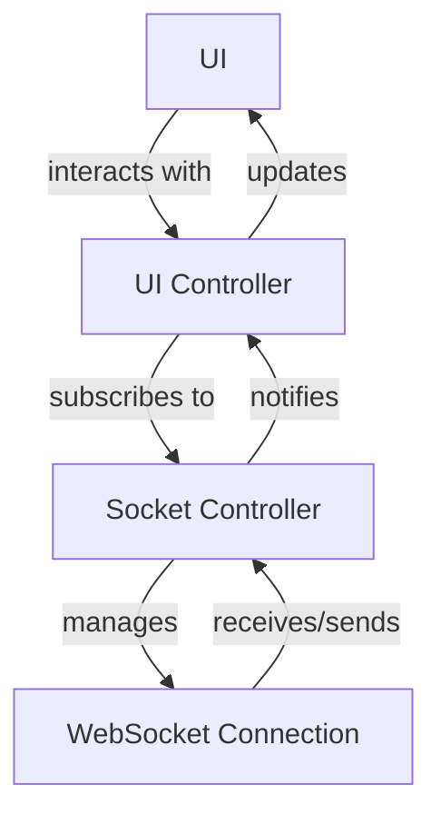

# WebSocket Architecture Documentation

## Overview
This document describes the WebSocket architecture used in the project, focusing on how the socket is built, the connection flow between the Socket Controller, UI Controller, and UI, as well as the lifecycle management (initialization and closure) of the WebSocket.

---

## Architecture Components

### 1. Socket Controller
- **Purpose:** Manages the WebSocket connection, handles events, messages, and reconnection logic.
- **Responsibilities:**
    - Establishes and maintains the WebSocket connection.
    - Listens for incoming messages and parses them.
    - Exposes methods to send messages to the server.
    - Handles connection errors and reconnection strategies.
    - Provides streams or callbacks for data/events to other layers.

### 2. UI Controller (ViewModel/State Controller)
- **Purpose:** Acts as an intermediary between the Socket Controller and the UI.
- **Responsibilities:**
    - Subscribes to streams or callbacks from the Socket Controller.
    - Processes and transforms socket data for UI consumption.
    - Updates UI state based on socket events.
    - Triggers socket actions (e.g., send message, reconnect) based on user interaction or app logic.

### 3. UI (Widgets/Screens)
- **Purpose:** Presents data to the user and handles user interactions.
- **Responsibilities:**
    - Displays data provided by the UI Controller.
    - Sends user actions (e.g., button presses) to the UI Controller, which may trigger socket actions.

---

## Connection Flow

---

## Socket Lifecycle

### Initialization
- **When:**
    - On app start or when entering a screen that requires real-time data.
    - Typically triggered in the UI Controller's `onInit`/`initState`/constructor.
- **How:**
    - UI Controller calls the Socket Controller's `connect()` or similar method.
    - Socket Controller establishes the WebSocket connection and starts listening for events.

### Closure
- **When:**
    - On app exit, logout, or when leaving the screen that requires the socket.
    - When a critical error occurs or the user is forcibly disconnected.
- **How:**
    - UI Controller calls the Socket Controller's `disconnect()` or similar method.
    - Socket Controller closes the WebSocket connection and cleans up resources.

---

## Best Practices
- **Singleton Pattern:** Use a singleton for the Socket Controller to avoid multiple connections.
- **Automatic Reconnection:** Implement reconnection logic in the Socket Controller for resilience.
- **Resource Management:** Always close the socket when not needed to free resources.
- **Error Handling:** Propagate errors from the Socket Controller to the UI Controller for user feedback.

---

## Example Sequence
1. **App/Screen Starts:** UI Controller initializes and requests the Socket Controller to connect.
2. **Socket Connects:** Socket Controller establishes the connection and starts emitting events.
3. **UI Updates:** UI Controller listens to events and updates the UI accordingly.
4. **User Leaves Screen/App:** UI Controller requests the Socket Controller to disconnect.
5. **Socket Closes:** Socket Controller cleans up the connection.

---

For implementation details, refer to the code in the `lib/realtime/` and `lib/sockets/` directories.